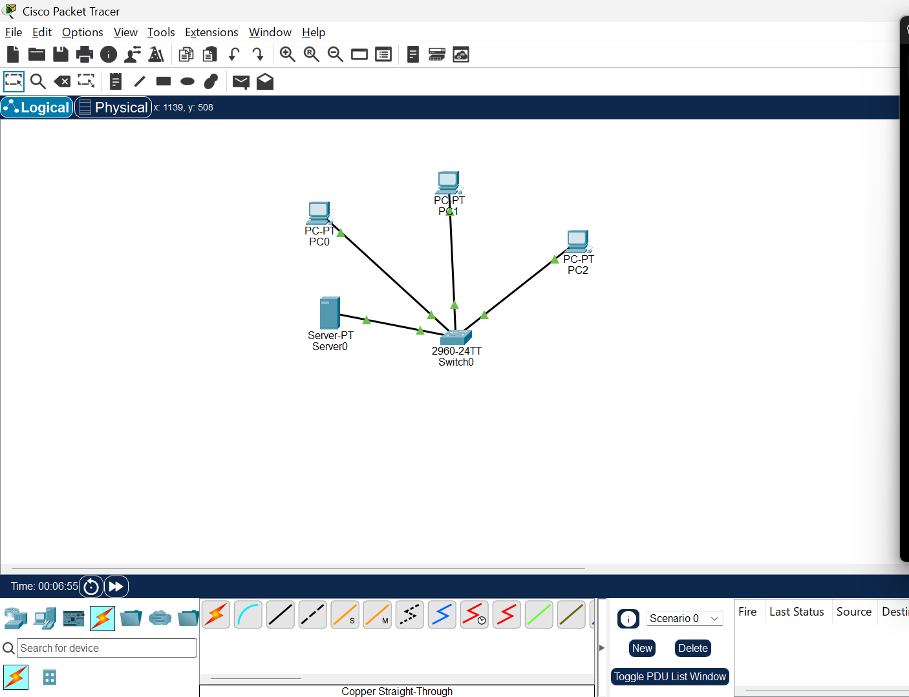
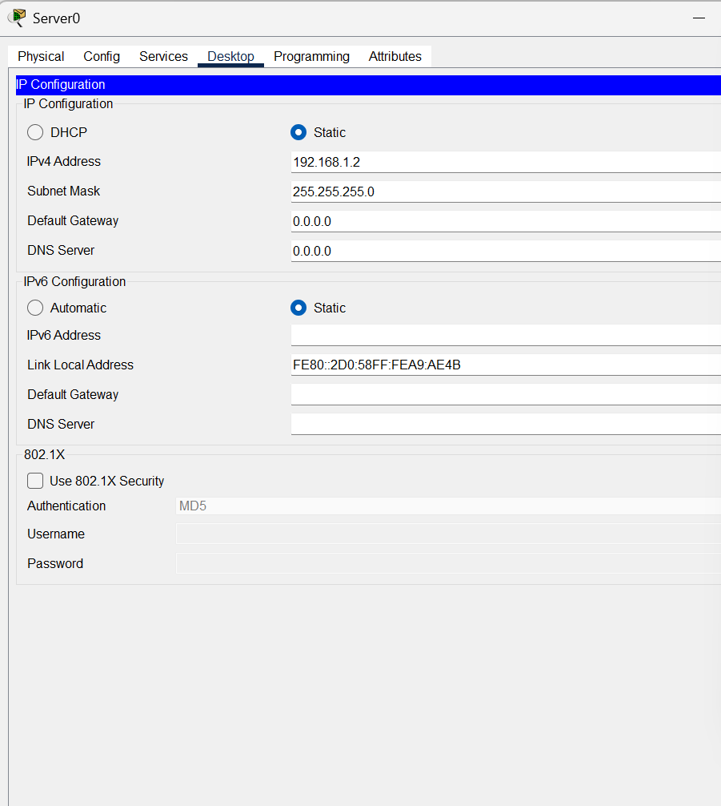
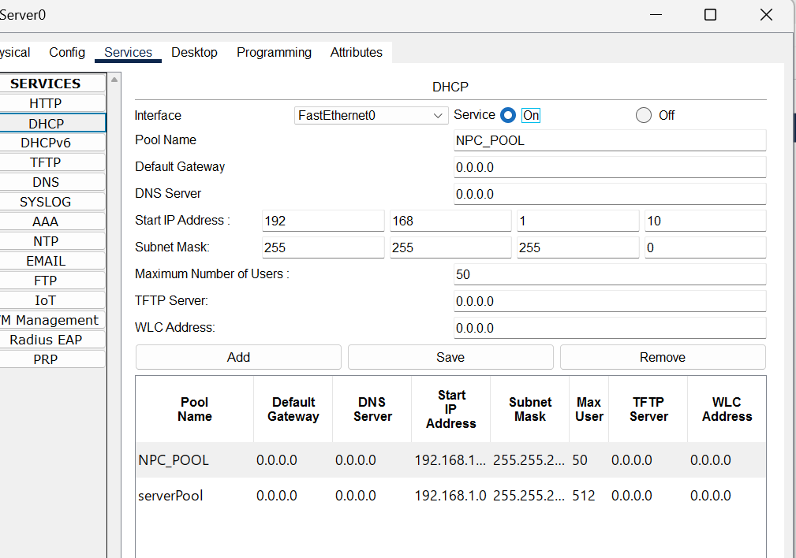
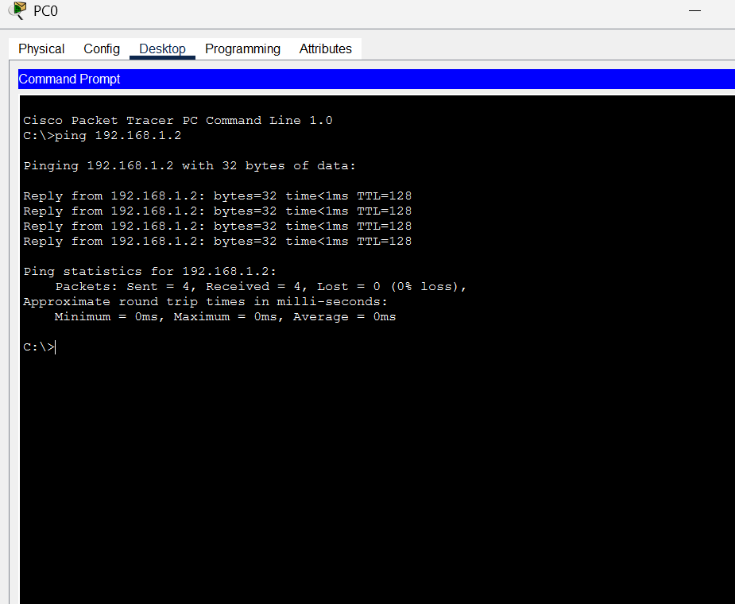
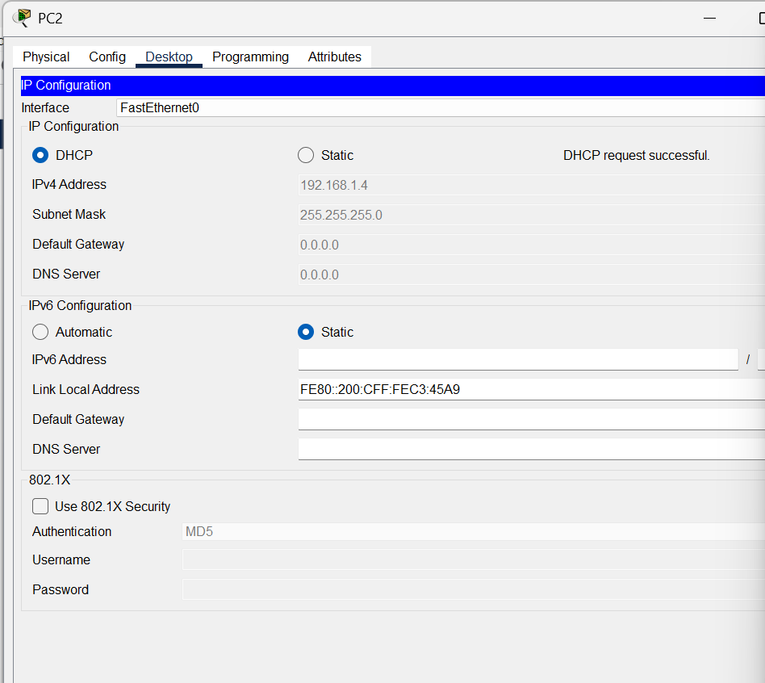
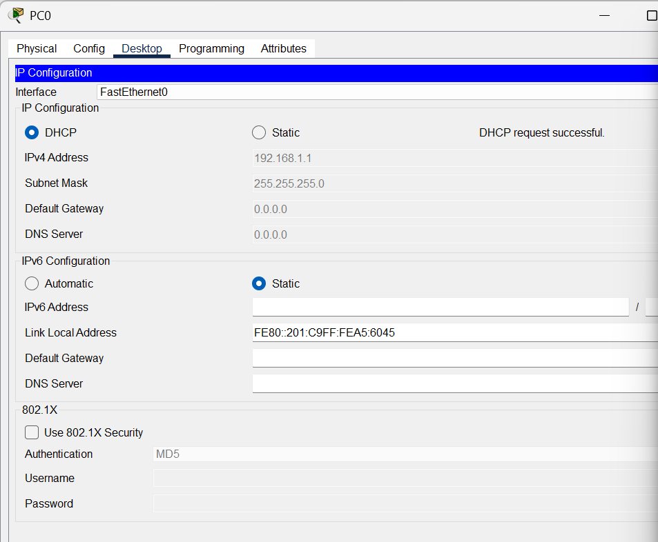
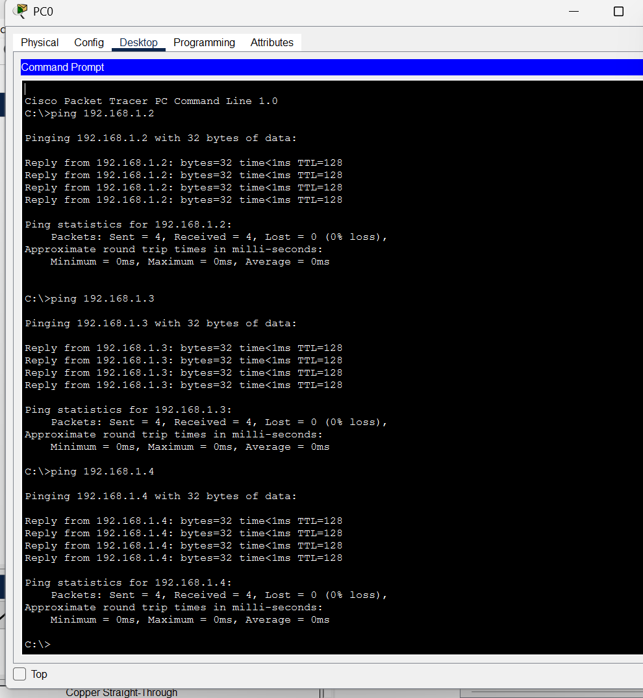

# NPC Assignment 4: DHCP Configuration and Network Setup

**Course / Module:** Unit 4: DHCP Configuration & Network Setup  
**Subject:** Network Protocols and Communication (NPC)  
**Author:** Vivek Borse  
**PRN:** 2125UCSM1082  
**Software:** Cisco Packet Tracer 9.0.1  
**Repository:** [Configure-DHCP-and-Set-Up-a-Network-Using-Cisco-Packet-Tracer](https://github.com/vivekborse99/Configure-DHCP-and-Set-Up-a-Network-Using-Cisco-Packet-Tracer)  

---

## 1. Aim
To design and configure a Local Area Network (LAN) in Cisco Packet Tracer, configure a central server with a static IPv4 address, enable and configure the DHCP service, dynamically assign IP configurations to client PCs, and verify end-to-end network connectivity using the ICMP ping command.

---

## 2. Hardware & Software Requirements
- **Simulation Software:** Cisco Packet Tracer (v9.0.1 or compatible)
- **Layer-2 Switch:** Cisco Catalyst 2960-24TT (Switch0)
- **Server:** Generic Server-PT (Server0 - DHCP Server)
- **End Devices:** 3 Client PCs (`PC0`, `PC1`, `PC2`)
- **Cabling:** Copper Straight-Through Ethernet Cables (FastEthernet links)

---

## 3. Network Topology
The network consists of a central Cisco 2960 switch connecting three client PCs and a dedicated DHCP server:

```text
               +-----------------------------+
               |  Server0 (DHCP Server)      |
               |  IP: 192.168.1.2/24         |
               +--------------+--------------+
                              | FastEthernet0
                              |
               +--------------+--------------+
               |   Switch0 (Cisco 2960-24TT) |
               +-------+------+-------+------+
                       |      |       |
         Fa0/1         |      |       | Fa0/3
     +-----------------+      |       +-----------------+
     |                 Fa0/2  |                         |
+----+--------+        +------+------+            +-----+-------+
|    PC0      |        |     PC1     |            |     PC2     |
| (via DHCP)  |        | (via DHCP)  |            | (via DHCP)  |
+-------------+        +-------------+            +-------------+
```

---

## 4. IP Addressing & DHCP Pool Configuration

### Server0 Static Configuration
| Parameter | Value |
|---|---|
| **Device** | Server0 |
| **Interface** | FastEthernet0 |
| **IP Configuration** | Static |
| **IPv4 Address** | `192.168.1.2` |
| **Subnet Mask** | `255.255.255.0` (/24) |
| **Default Gateway** | `0.0.0.0` (Local LAN) |
| **DNS Server** | `0.0.0.0` |

### DHCP Service Settings (`NPC_POOL`)
| Setting | Configured Value | Description |
|---|---|---|
| **Service Status** | On | Enables DHCP daemon on Server0 |
| **Pool Name** | `NPC_POOL` | Custom DHCP IP scope |
| **Default Gateway** | `0.0.0.0` | Local network broadcast segment |
| **DNS Server** | `0.0.0.0` | Not required for local test |
| **Start IP Address** | `192.168.1.10` | First assignable host address |
| **Subnet Mask** | `255.255.255.0` | Class C default subnet |
| **Maximum Number of Users** | `50` | Maximum dynamic leases allowed |

---

## 5. Configuration Procedure
1. **Device Placement:** Placed 1 Cisco 2960 switch, 1 Generic Server, and 3 PCs in the Cisco Packet Tracer workspace.
2. **Cabling:** Connected each PC and Server0 to switch ports using Copper Straight-Through cables.
3. **Static Server Setup:** Opened Server0 -> `Desktop` -> `IP Configuration`, assigned static IP `192.168.1.2` and subnet mask `255.255.255.0`.
4. **DHCP Pool Creation:** Navigated to Server0 -> `Services` -> `DHCP`. Switched service **On**, named the pool `NPC_POOL`, specified start IP `192.168.1.10`, subnet mask `255.255.255.0`, and max users `50`, then saved the configuration.
5. **Dynamic Client Allocation:** Opened `Desktop` -> `IP Configuration` on `PC0`, `PC1`, and `PC2`, selected the **DHCP** radio button, and verified the "DHCP request successful" message.
6. **Connectivity Verification:** From `PC0` Command Prompt, executed `ping` commands to `Server0 (192.168.1.2)`, `PC1`, and `PC2` to verify full communication.

---

## 6. Screenshots & Visual Evidence

### Figure 1: Network Topology
Cisco Packet Tracer workspace showing `Server0`, `Switch0`, `PC0`, `PC1`, and `PC2` with green operational link lights:


### Figure 2: Server0 Static IPv4 Configuration
Static assignment of `192.168.1.2` on Server0 FastEthernet0:


### Figure 3: DHCP Service & Pool Settings
DHCP service enabled with `NPC_POOL` parameters:


### Figure 4: PC0 Dynamic IP Configuration
Successful DHCP request on PC0:


### Figure 5: PC1 Dynamic IP Configuration
Successful DHCP request on PC1:


### Figure 6: PC2 Dynamic IP Configuration
Successful DHCP request on PC2:


### Figure 7: ICMP Ping Connectivity Test
Successful ping responses from PC0 to Server0, PC1, and PC2 (0% packet loss):


---

## 7. Results & Verification
- **DHCP Operation:** Dynamic host configuration protocol successfully leased valid IP parameters across all 3 end devices on the subnet.
- **ICMP Ping Results:**
  - `PC0` -> `Server0 (192.168.1.2)`: 4/4 packets received, 0% loss (Average < 1ms)
  - `PC0` -> `PC1 (192.168.1.3)`: 4/4 packets received, 0% loss (Average < 1ms)
  - `PC0` -> `PC2 (192.168.1.4)`: 4/4 packets received, 0% loss (Average < 1ms)

---

## 8. Files in Repository
- `NPC_Unit4_DHCP_Assignment.pkt`: Cisco Packet Tracer simulation project file.
- `NPC_Unit4_DHCP_Assignment_Report.pdf`: Complete assignment report in PDF format.
- `NPC_Unit4_DHCP_Assignment_Report.docx`: Editable assignment report in Word format.
- `screenshots/`: Folder containing all high-resolution configuration & testing screenshots (Figures 1 to 7).
- `README.md`: Comprehensive project overview and documentation.

---

## 9. GitHub Repository
- **Repository URL:** [https://github.com/vivekborse99/Configure-DHCP-and-Set-Up-a-Network-Using-Cisco-Packet-Tracer](https://github.com/vivekborse99/Configure-DHCP-and-Set-Up-a-Network-Using-Cisco-Packet-Tracer)
- **Clone Command:**
  ```bash
  git clone https://github.com/vivekborse99/Configure-DHCP-and-Set-Up-a-Network-Using-Cisco-Packet-Tracer.git
  ```
